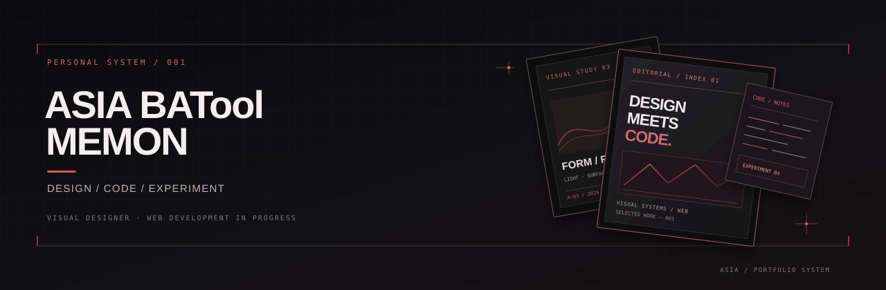

  

<h1 align="center">ASIA BATOOL MEMON</h1>

  <em>Creative Designer | Full-Stack Developer in Progress</em>

  Blending creativity, design & technology to build meaningful digital experiences.

  <a href="www.linkedin.com/in/asia-batool-memon">LinkedIn</a>

---

## 01 / ABOUT

I'm a creative designer exploring the intersection of visual design and development.

I enjoy experimenting with ideas, creating digital experiences, and learning by building projects.

## 02 / TOOLKIT

  

## 03 / SELECTED WORK

### AcousticX

*A static website built with HTML and CSS.*

An exploration of web layout, visual styling, and front-end development.

  <a href="https://asiabatoolmemon.github.io/AcousticX/">↗ Live Demo</a>
  &nbsp;·&nbsp;
  <a href="https://github.com/asiabatoolmemon/AcousticX">⌘ View Source Code</a>

---

## 04 / CURRENTLY EXPLORING

- Responsive web design
- Creative development
- Building meaningful digital experiences
- Expanding my full-stack development skills

---

## 05 / CONNECT

  <a href="www.linkedin.com/in/asia-batool-memon">LinkedIn</a>
  &nbsp;·&nbsp;
  <a href="https://github.com/asiabatoolmemon">GitHub</a>

---

  DESIGN THOUGHTFULLY. BUILD INTENTIONALLY.

